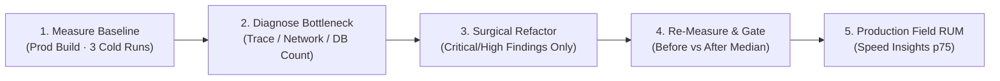

# Nondii Performance Verification & CI Budget Gate Workflow

Distilled from WeGlobal's `docs/PERFORMANCE_SKILLS_GUIDE.md`, `08-page-speed-performance-plan.md`, and `scripts/performance/*`.

---

## 1. The 5-Step Closed-Loop Performance Workflow

Never optimize by guessing. Every performance PR in `my-hotel` MUST follow this loop:



### Ironclad Measurement Rules
1. **NEVER measure on `npm run dev`!** Dev mode skips bundling, tree-shaking, RSC caching, and static optimization. Always run:
   ```bash
   npm run build && PORT=3004 npm run start
   ```
2. **Always capture 3 cold mobile runs per route** and report **median + min/max range** (a single run has high variance and cannot prove improvement).
3. **Never confuse Lab vs Field (CrUX/RUM):** Localhost TTFB and local Next image cache do NOT prove production Neon DB/CDN speed. Confirm production p75 via consent-aware RUM after deploy.
4. **Never claim improvement within noise:** If LCP moves by `<3%` within run-to-run variance, report it honestly as no significant change and inspect the actual trace subpart (TTFB vs Load Delay vs Load Duration vs Render Delay).

---

## 2. Target Route Matrix & Hard Budgets for Nondii

### Core Public & Interactive Routes to Audit
1. `home` — `/` (Main Discovery Feed)
2. `explore` — `/explore` (Map + Card Strip Explorer)
3. `place-profile` — `/<verified-hotel-slug>` (Place / Stay Storefront — Direct Booking)
4. `place-checkout` — `/<verified-hotel-slug>/book` (Checkout Flow)
5. `interactive-in-page` — Authenticated Save-to-Board / Like / Open Place Modal / Map Pan-Zoom (INP Trace)

### Enforced Performance Budgets

| Metric | Goal (Field p75) | Hard CI Gate (Mobile Lab Median) | Zero-Tolerance Guard |
|---|---:|---:|---|
| **LCP** | `<= 2.5s` | `<= 4.0s` (warn if `> 2.5s`) | LCP image MUST be `discoverable`, `eager`, `fetchPriority="high"` |
| **INP** | `<= 200ms` | `<= 200ms` (real interaction trace) | Must include raw CDP trace + Event Timing samples |
| **CLS** | `<= 0.1` | `<= 0.1` | **NO outlier > 0.1** in ANY of the 3 runs |
| **TBT** | `<= 200ms` | `<= 200ms` | Avoid premature `useMemo` when TBT is already low |
| **TTFB** | `<= 800ms` | `<= 800ms` | Verify warm cache hit vs cold miss separately |
| **Total Transfer** | `<= 1.5 MB` | `<= 1.5 MB` | JS `< 300KB`, CSS `< 100KB`, Above-fold Images `< 500KB`, Fonts `< 100KB`, 3P `< 200KB` |

---

## 3. Recommended Automation Harness (`scripts/performance/`)

Port WeGlobal's deterministic performance harness into `my-hotel`:

```text
scripts/performance/
├── run-lighthouse.mjs       # Runs 3 cold mobile Lighthouse audits per route -> raw JSON + summary.json (schemaVersion: 2)
├── check-budgets.mjs        # Validates summary freshness (<=24h), git commit match, raw-vs-median integrity, budgets, and CLS outliers
└── run-interaction-inp.mjs  # Playwright + CDP trace measuring real INP (open place card, like/save, switch category tab)
```

Suggested `package.json` scripts:
```json
{
  "perf:audit": "node scripts/performance/run-lighthouse.mjs",
  "perf:check": "node scripts/performance/check-budgets.mjs",
  "perf:inp": "node scripts/performance/run-interaction-inp.mjs",
  "perf:ci": "npm run build && node scripts/performance/run-ci.mjs && npm run perf:check"
}
```

### Schema-2 Budget Gate Contract (Adapted from WeGlobal `check-budgets.mjs`)
Every `summary.json` verified by `perf:check` MUST validate:
1. `schemaVersion === 2`
2. Capture age `<= 24 hours` and `environment.gitCommit === git rev-parse --short HEAD` (prevents stale reports passing CI)
3. `runs >= 3` per required route with zero runtime errors and zero unexpected redirects
4. Recalculated median from raw Lighthouse JSON files matches `summary.json` exactly
5. Every metric passes its budget AND `Math.max(...clsValues) <= 0.1` (zero CLS outlier allowed)

---

## 4. Consent-Aware Real-User Monitoring (RUM)

Mirror WeGlobal's `ConsentSpeedInsights.tsx` in `src/app/layout.tsx`:
- Integrate `@vercel/speed-insights/next` gated strictly behind Nondii's existing `CGR_CONSENT_COOKIE === "analytics"` consent state (`CookieConsentBanner`).
- NEVER log PII, phone numbers, booking codes, or search text in telemetry.
- Use RUM field p75 data (LCP, INP, CLS, TTFB by route & device) to prioritize future optimization sprints — just like WeGlobal's `vercel-optimize` metrics-first workflow.

---

## 5. Required Evidence in Every Performance PR

Attach a concise Thai/English report table before closing any speed optimization task:

| Route | Metric | Baseline Median (Range) | After Median (Range) | Delta | Status |
|---|---|---:|---:|---:|---|
| `/` | LCP / TTFB / CLS / Transfer | ... | ... | ... | PASS / FAIL |

Plus:
- Exact **LCP element** before vs after (`requestDiscoverable`, `eagerlyLoaded`, `priorityHinted`)
- Network byte breakdown (Image / JS / CSS / Font)
- Verification results: `npx tsc --noEmit`, `npm run lint`, `npm run build`, mobile/desktop visual parity (390px / 768px / 1440px, zero horizontal overflow)
- Explicit note of any remaining limitations (e.g., localhost vs production CrUX p75).
