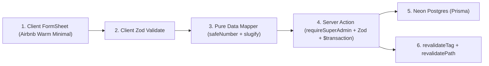

# Nondii Super-Admin & Dynamic Category / Type Architecture Blueprint

> **Design System Reminder:** WeGlobal (`my-shop`) provides the **backend architecture, data flow, and safety mechanisms** below. Every UI component rendered in Nondii's `/super-admin` **MUST** follow `.agents/skills/my-hotel-design-system/SKILL.md` (Airbnb Warm Minimal: `#ffffff`/`#161616` canvas, `#222222`/`#f5f5f5` primary squircle buttons, flat `#f7f7f7` secondary buttons, `divide-y` hairlines, `<StandardInput />`, `<ResponsiveSelect />`, `<StandardCheckbox />`, `useModalPresence` Slide-Up Bottom Sheets, **ZERO hover scale**, **ZERO card/button drop shadows**, **ZERO blue/pastel buttons**).

---

## 1. Complete `/super-admin` Control Plane Map for Nondii

Replace the legacy 3-tab client-only `/super-admin/page.tsx` with a modular, server-guarded control plane modeled on WeGlobal's `/admin`:

```text
src/app/super-admin/
├── layout.tsx                   # Server Component RBAC guard (SUPER_ADMIN only) + Admin Shell
├── page.tsx                     # Overview Dashboard: KPIs + Pre-Aggregated PlaceStats Table
├── categories/page.tsx          # Dynamic Place Types / Sub-Types / Styles (Miller Columns + DnD + Safe Move)
├── attributes/page.tsx          # Dynamic Amenities, Facilities & Filter Facets bound per Category
├── places/page.tsx              # Verified Stay approval queue, bulk Category/Type switcher, Publish toggle
├── reports/page.tsx             # PlaceReport moderation queue (DUPLICATE / FAKE_SCAM / CLOSED / WRONG_LOCATION)
├── campaigns/page.tsx           # Sponsored Pins, Featured Deals, Ad Placements & Priority
├── media/page.tsx               # Shared Media Library & Audit (orphan/oversized asset check)
└── systems/page.tsx             # Tabbed Hub: General | Global SEO | Homepage Appearance | Search Synonyms | AI Prompts | Users & RBAC
```

> **Admin vs Host (`/studio`) Unification Rule (from WeGlobal `admin_seller_unify_plan.md`):**
> Share reusable primitives (`DashboardOverview`, `PlaceStatsTable`, `MediaLibrary`, `PlaceFormSheet`) between `/super-admin` and `/studio` via a `role: "SUPER_ADMIN" | "HOTEL_OWNER"` prop — Super-Admin sees platform-wide rows + moderation/verification/category controls, while Host sees only `ownerId === user.id`.

---

## 2. Standardized 5-File Module Pattern (Mandatory for Every Admin Feature)

Distilled directly from WeGlobal's `admin_architecture_blueprint.md`:



| Layer | File Path Convention | Strict Rules |
|---|---|---|
| **1. Schema** | `src/lib/schemas/<entity>.schema.ts` | Zod schema + inferred `FormValues` type. **NEVER import in public storefront client components** (keeps Zod out of public JS bundle). |
| **2. Mapper** | `src/lib/mappers/<entity>.mapper.ts` | Pure `map<Entity>FormToPayload()` with `safeNumber()` (prevents `NaN` crashes) + `slugify()`. Also holds explicit server-to-client DTO mappers converting Prisma `Decimal -> Number` and `Date -> ISO string`. **NEVER use `JSON.parse(JSON.stringify(...))`**. |
| **3. Server Action** | `src/actions/admin/<entities>.ts` | Starts with `await requireSuperAdmin()`. Validates with Zod, runs `generateUniqueSlug()`, wraps multi-table changes in `prisma.$transaction()`, and calls `revalidatePlaceCatalog()` / `revalidateTag(..., "max")` before returning `{ success, data?, error? }`. |
| **4. FormSheet** | `src/components/super-admin/<entity>/<Entity>FormSheet.tsx` | Uses `useModalPresence` (Desktop Drawer / Mobile Slide-Up Bottom Sheet), `<StandardInput />`, `<ResponsiveSelect />`, `<StandardCheckbox />`. Wraps submit in `try/catch` handling `z.ZodError`. |
| **5. Client View** | `src/components/super-admin/<entity>/<Entity>Client.tsx` | Receives lean `initialData` from Server Component, applies **optimistic updates** on reorder/move/toggle, lazy-loads heavy child lists on demand, and merges refreshed server props without wiping lazily loaded state. |

### Server-to-Client Sync Pattern (Avoid Stale State After `router.refresh()`)
```tsx
// Preserve lazily-loaded places while syncing fresh category metadata from server
const lastInitialRef = useRef(initialCategories);
if (lastInitialRef.current !== initialCategories) {
  lastInitialRef.current = initialCategories;
  setCategories((prev) => {
    const loadedPlacesMap = new Map(
      prev.filter((c) => c.places?.length).map((c) => [c.id, c.places!])
    );
    return initialCategories.map((c) => ({
      ...c,
      places: loadedPlacesMap.get(c.id) ?? c.places ?? [],
    }));
  });
}
```

---

## 3. Dynamic Place Category & Type System (Solving Hardcoded Types in Nondii)

### The Current Problem in Nondii
Currently, Place Types (`PlaceCategory`: `STAY`, `CAFE`, `RESTAURANT`, `ATTRACTION`, `WELLNESS`), Property Sub-Types (`PropertyType`: `BOUTIQUE_HOTEL`, `RESORT`, `POOL_VILLA`, `GLAMPING_HOMESTAY`), and Style Tabs (`STAY_STYLE_TABS` / `VALID_STYLE_TAGS`) are hardcoded across `prisma/schema.prisma`, `src/lib/placeCategories.ts`, and `src/data/thailandProvinces.ts`. Super-Admin cannot add a new Place Type (e.g., `BEACH_CLUB`, `CO_WORKING`, `NIGHT_MARKET`), edit labels/colors/CTA/Schema.org types, nest sub-categories, or safely migrate places without a code deploy.

### Recommended Prisma Schema (Adapted from WeGlobal `Category` + Nondii Domain)

```prisma
model PlaceCategoryConfig {
  id                  String   @id @default(cuid())
  code                String   @unique // e.g., "STAY", "CAFE", "POOL_VILLA", "SPECIALTY_COFFEE"
  slug                String   @unique // URL-friendly slug, e.g., "stay", "pool-villa"
  labelTh             String
  labelEn             String
  shortLabelTh        String   @default("")
  shortLabelEn        String   @default("")
  descriptionTh       String?
  descriptionEn       String?
  iconKey             String   @default("BedDouble") // Lucide icon key
  crestBgHex          String   @default("#2B3A67")   // Scoped strictly to 3:4 Card Crest & Map Pin!
  coverImageUrl       String?
  bannerImageUrl      String?
  schemaOrgType       String   @default("LodgingBusiness")
  defaultCtaTh        String   @default("ดูรายละเอียด")
  defaultCtaEn        String   @default("View Details")
  defaultMerchantMode MerchantMode @default(PROFILE_ONLY)
  level               Int      @default(1) // 1 = Root Type, 2 = Sub-Type, 3 = Style/Collection
  position            Int      @default(0)
  isActive            Boolean  @default(true)
  isSystem            Boolean  @default(false) // Protects core root types from accidental deletion
  parentId            String?
  parent              PlaceCategoryConfig?  @relation("PlaceCategoryTree", fields: [parentId], references: [id])
  children            PlaceCategoryConfig[] @relation("PlaceCategoryTree")
  hotels              Hotel[]               @relation("HotelPrimaryCategory")
  secondaryHotels     HotelCategoryLink[]
  attributes          CategoryAttributeBinding[]
  createdAt           DateTime @default(now())
  updatedAt           DateTime @updatedAt

  @@index([parentId, position])
  @@index([level, isActive, position])
}

// Many-to-many join so one place can belong to 1 primary Type + multiple Sub-Types/Styles
model HotelCategoryLink {
  hotelId    String
  categoryId String
  isPrimary  Boolean             @default(false)
  hotel      Hotel               @relation(fields: [hotelId], references: [id], onDelete: Cascade)
  category   PlaceCategoryConfig @relation(fields: [categoryId], references: [id], onDelete: Cascade)

  @@id([hotelId, categoryId])
  @@index([categoryId, hotelId])
}
```

### Zero-Downtime Migration Strategy (Hardcoded Enum -> DB Table)
1. **Phase A (Dual-Write / Seed):** Seed the 5 core `PlaceCategory` roots (`STAY`, `CAFE`, `RESTAURANT`, `ATTRACTION`, `WELLNESS` with `isSystem: true`), their `PropertyType` children (`BOUTIQUE_HOTEL`, `RESORT`, `POOL_VILLA`, `GLAMPING_HOMESTAY`), and `STAY_STYLE_TABS` into `PlaceCategoryConfig`. Backfill `Hotel.primaryCategoryId` and `HotelCategoryLink`.
2. **Phase B (Cached DB Read with Static Fallback):** Expose `getPlaceCategoryHierarchy()` wrapped in `unstable_cache(..., ["place-category-hierarchy-v1"], { revalidate: 3600, tags: ["place-categories"] })`, returning the cached tree to `/`, `/explore`, `/{hotelSlug}`, and `/studio`. Keep `PLACE_CATEGORIES` as a lightweight fallback map for initial seed & crest token defaults.
3. **Phase C (Super-Admin Full Control):** Super-Admin creates/edits/reorders/moves any Type or Sub-Type live; saving calls `revalidateTag("place-categories", "max")` + `revalidatePlaceCatalog()` so the entire site updates immediately without redeploying!

### Critical Category Safety & UX Rules (Learned from WeGlobal `CategoryClient` + `MoveCategoryModal` + `categories.ts`)
1. **Lean Initial Load + Lazy Children:** `/super-admin/categories/page.tsx` fetches `getCategories({ includePlaces: false })` + `getUncategorizedPlaces()` in `Promise.all`. Individual places inside a category are fetched ONLY when clicked (`fetchCategoryPlaces(categoryId)` cached in `loadedCategoryIds` Set).
2. **Miller-Column Hierarchy + `@dnd-kit` Reorder:**
   - Column 1: Root Place Types (L1) | Column 2: Sub-Types (L2) | Column 3: Styles / Leaf Tags (L3) | Column 4: Places inside selected leaf + **Uncategorized Drop Zone** toolbar button.
   - Reordering updates local state optimistically, then calls `updateCategoryPositions(items)` inside `prisma.$transaction(...)`.
3. **Cycle & Max-Depth Guard (`MoveCategoryModal`):**
   - Collect all `descendantIds` of the moving category -> forbid moving into self or any descendant.
   - Compute `subtreeDepth` -> allow drop ONLY where `targetParentLevel + subtreeDepth <= 3`.
   - Enforce unique name within the same `parentId` and never allow child name === parent name.
4. **Transactional Safety on Delete / Level Change:**
   - System roots (`isSystem: true`) cannot be deleted (only renamed/recolored/hidden via `isActive: false` if needed).
   - Deleting a custom category or changing its level MUST run inside `prisma.$transaction`: reassign affected `Hotel`/`HotelCategoryLink` rows to either a selected **replacement category** or `null` (`Uncategorized` staging tray) BEFORE deleting child/target categories.
   - Always invalidate tags `"place-categories"`, `"places"`, `"place-list"`, `"home-feed"`, `"explore-feed"`.

---

## 4. Dynamic Attributes, Amenities & Facet System (Adapted from WeGlobal `Attribute`)

Allows Super-Admin to control structured filters per Place Type (e.g., `STAY`: Pool, Bathtub, Pet-Friendly, Breakfast; `CAFE`: Slow Bar, Power Outlets, Wi-Fi, Parking; `WELLNESS`: Onsen, Private Room) without schema changes:

```prisma
model PlaceAttribute {
  id         String                     @id @default(cuid())
  nameTh     String
  nameEn     String
  slug       String                     @unique
  iconKey    String?
  filterType String                     @default("checkbox") // checkbox | boolean | single
  position   Int                        @default(0)
  values     PlaceAttributeValue[]
  categories CategoryAttributeBinding[]
  createdAt  DateTime                   @default(now())
  updatedAt  DateTime                   @updatedAt
}

model PlaceAttributeValue {
  id          String                @id @default(cuid())
  attributeId String
  valueTh     String
  valueEn     String                @default("")
  slug        String
  position    Int                   @default(0)
  attribute   PlaceAttribute        @relation(fields: [attributeId], references: [id], onDelete: Cascade)
  hotels      HotelAttributeValue[]

  @@unique([attributeId, slug])
  @@index([attributeId])
}

model CategoryAttributeBinding {
  categoryId  String
  attributeId String
  isRequired  Boolean             @default(false)
  position    Int                 @default(0)
  category    PlaceCategoryConfig @relation(fields: [categoryId], references: [id], onDelete: Cascade)
  attribute   PlaceAttribute      @relation(fields: [attributeId], references: [id], onDelete: Cascade)

  @@id([categoryId, attributeId])
}

model HotelAttributeValue {
  id      String              @id @default(cuid())
  hotelId String
  valueId String
  hotel   Hotel               @relation(fields: [hotelId], references: [id], onDelete: Cascade)
  value   PlaceAttributeValue @relation(fields: [valueId], references: [id], onDelete: Cascade)

  @@unique([hotelId, valueId])
  @@index([hotelId])
  @@index([valueId, hotelId]) // CRITICAL PIVOT INDEX for fast DB-first facet counts!
}
```

### Mandatory Attribute Action Rules (from WeGlobal `src/actions/attributes.ts`)
- **In-Use Deletion Guard:** Before deleting a `PlaceAttributeValue`, run `prisma.hotelAttributeValue.count({ where: { valueId } })`. If `> 0`, refuse deletion and return `{ success: false, inUse: true, count }` (offer merge/reassign instead).
- **"Quiet" Inline Mutations:** Provide `addAttributeValueQuiet` (omits `revalidatePath`) for inline tag creation inside a Place/Studio form so unsaved form inputs don't reset.
- **Diff-Based Bulk Assignment:** Pass `{ added: string[], removed: string[] }` inside `prisma.$transaction` so bulk tagging hundreds of places is atomic and fast.

---

## 5. System Config, Search Synonyms & AI Prompts (`/super-admin/systems`)

Modeled on WeGlobal's `SeoAppearance`, `SearchSynonymGroup`, and `AiPrompt` tables:

```prisma
model SystemConfig {
  id        String   @id @default(cuid())
  key       String   @unique // "settings_general" | "global_seo" | "home_appearance" | "ad_pricing" | "feature_flags"
  value     Json
  updatedBy String?
  createdAt DateTime @default(now())
  updatedAt DateTime @updatedAt
}

model AiPrompt {
  id        String   @id @default(cuid())
  key       String   @unique // "fb_sync_triage" | "room_photo_organizer" | "place_summary"
  prompt    String
  updatedBy String?
  createdAt DateTime @default(now())
  updatedAt DateTime @updatedAt
}

// 3-Level Search Synonym Engine (Thai / English / Slang / Province Abbreviations)
// Example: Group "พูลวิลล่า" -> Display "Pool Villa" -> Synonyms ["พูลวิล่า", "บ้านพักมีสระ", "villa สระส่วนตัว"]
model SearchSynonymGroup {
  id        String                 @id @default(cuid())
  keyword   String                 @unique
  displays  SearchSynonymDisplay[]
  createdAt DateTime               @default(now())
  updatedAt DateTime               @updatedAt
}

model SearchSynonymDisplay {
  id        String             @id @default(cuid())
  term      String
  groupId   String
  group     SearchSynonymGroup @relation(fields: [groupId], references: [id], onDelete: Cascade)
  synonyms  SearchSynonym[]
  createdAt DateTime           @default(now())
  updatedAt DateTime           @updatedAt
}

model SearchSynonym {
  id        String               @id @default(cuid())
  keyword   String               @unique
  displayId String
  display   SearchSynonymDisplay @relation(fields: [displayId], references: [id], onDelete: Cascade)
  createdAt DateTime             @default(now())
}
```

- **Caching Rule:** Read `SystemConfig` via `getSystemConfig(key)` wrapped in `unstable_cache(..., ["system-config-v1"], { revalidate: 3600, tags: ["appearance"] })`. Updating any config immediately fires `revalidateTag("appearance", "max")`.
- **Caching Synonyms:** Read synonym lookup map via `unstable_cache(..., ["search-synonyms-v1"], { revalidate: 3600, tags: ["synonyms"] })` and expand user queries in `searchDiscoveryPins()` before building the SQL `WHERE` clause.

---

## 6. Defense-in-Depth Super-Admin Security & Audit Guard

1. **Server Layout Gate (`src/app/super-admin/layout.tsx`):**
   ```tsx
   import { redirect } from "next/navigation";
   import { getServerSessionUser } from "@/lib/auth/session";

   export default async function SuperAdminLayout({ children }: { children: React.ReactNode }) {
     const user = await getServerSessionUser();
     if (!user) redirect("/login?callbackUrl=/super-admin");
     if (user.role !== "SUPER_ADMIN") redirect("/");
     return <SuperAdminShell user={user}>{children}</SuperAdminShell>;
   }
   ```
2. **Action / Route Helper (`src/lib/auth/requireSuperAdmin.ts`):**
   Every single `/super-admin` Server Action and `/api/super-admin/*` route MUST begin with `const admin = await requireSuperAdmin();` (throws/returns `403` otherwise).
3. **No Public Bundle Leakage:** Keep all super-admin components, charts, DnD kits, and Zod schemas strictly under `src/components/super-admin/` and `src/lib/schemas/` so public storefront routes pay **0 KB** for the entire super-admin console.
