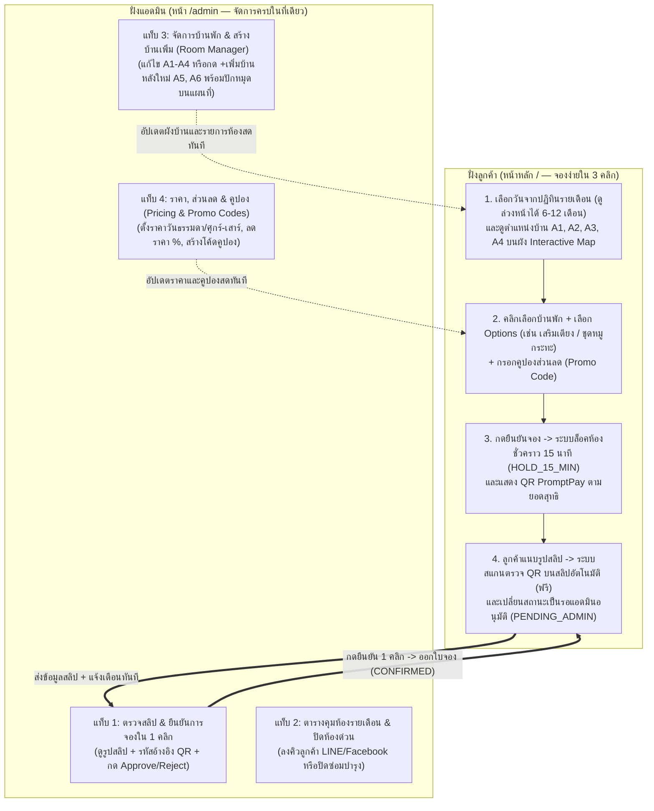

# Sapan Unseen — Master Booking & Admin Architecture Plan (`booking-flow.md`)

เอกสารฉบับนี้ออกแบบสำหรับระบบจองห้องพักและระบบหลังบ้านอย่างเป็นทางการของ **สะปัน อันซีน น่าน (Sapan Unseen)** โดยผสานดีไซน์ระดับโลกสไตล์ **The Bolder (`Rock & Mist` Theme)** เข้ากับจุดแข็งของ **RoomScope** (ผังตำแหน่งบ้านพัก + ปฏิทินเช็คคิวว่างล่วงหน้าหลายเดือน) พร้อมระบบ **Admin หลังบ้านเต็มรูปแบบ** ที่รองรับการขยายธุรกิจในอนาคต

---

## 1. ข้อมูลจริงของที่พัก (Sapan Unseen Official Specs)

* **ชื่อโครงการ:** สะปัน อันซีน น่าน (Sapan Unseen) — ต.ดงพญา อ.บ่อเกลือ จ.น่าน
* **ช่องทางติดต่อ:** โทร `095-779-7971`, `086-769-9779` | LINE Official: `@sapanunseen`
* **เวลาเข้าพัก:** เช็คอิน `14:00 น.` / เช็คเอาท์ `11:00 น.` (รวมอาหารเช้าเสิร์ฟ `08:00 – 09:30 น.`)
* **รหัสบ้านพักเริ่มต้น 4 หลัง (`A1, A2, A3, A4`) — *เพิ่มหลังใหม่จากหน้า Admin ได้เมื่อสร้างเพิ่ม*:**
  * **`A1` — A-Frame Panorama Villa 1:** บ้านทรง A-Frame 2 ชั้น (ชั้นล่างเตียงชมวิวภูเขา + ชั้นลอยใต้หลังคา) พร้อมระเบียงและอ่างแช่น้ำกลางแจ้ง (Outdoor Bathtub) รองรับมาตรฐาน 2 ท่าน (เสริมได้สูงสุด 4–5 ท่าน)
  * **`A2` — A-Frame Panorama Villa 2:** บ้านทรง A-Frame 2 ชั้น คู่กับหลัง A1 เหมาะทั้งพักเดี่ยวหรือจองคู่สำหรับกลุ่มเพื่อน/ครอบครัว พร้อมอ่างแช่น้ำชมทะเลหมอก
  * **`A3` — Mist Suite Cabin 3:** บ้านพักโซนด้านในวิวเปิดกว้างสำหรับ 2 ท่าน (เสริมได้ 1 ท่าน) เงียบสงบใกล้ชิดธรรมชาติ
  * **`A4` — Private Corner Cabin 4:** บ้านพักหลังริมสุดทางเดิน ให้ความเป็นส่วนตัวสูงสุดท่ามกลางขุนเขาและสายหมอก
* **กฎระเบียบและเงื่อนไขการเข้าพัก:**
  * เด็กอายุ 0–5 ปี เข้าพักฟรี (ไม่เสริมที่นอน) / บริการเสริมที่นอนสำหรับผู้เข้าพักเพิ่ม ท่านละ `850 บาท/คืน`
  * ไม่อนุญาตให้นำสัตว์เลี้ยงเข้าพัก / งดสูบบุหรี่ในห้องพัก / งดส่งเสียงดังหลังเวลา `20:30 น.`

---

## 2. แผนผังการทำงานครบวงจร (End-to-End Customer & Admin Flow)

---

## 3. รายละเอียดระบบตรวจสลิป (Smart QR Slip Scanner + 1-Click Admin Approval)

ตามที่คุณเลือกแนวทาง **"สแกนเช็ค QR สลิปจริงเบื้องต้นฟรี + แอดมินกดยืนยันในหน้า `/admin` 1 คลิก"** ระบบจะทำงานเป็น 3 ชั้นดังนี้ครับ:

1. **ล็อคคิวห้องพักชั่วคราว 15 นาที (`HOLD_15_MIN`):**
   * ทันทีที่ลูกค้ากดสร้างรายการจอง บ้านหลังนั้นจะขึ้นสถานะ **`🟠 ล็อคชั่วคราว (กำลังชำระเงิน)`** บนผังที่พักและปฏิทินเป็นเวลา 15 นาที เพื่อป้องกันลูกค้าคนอื่นโอนเงินซ้อน
2. **สแกนตรวจ QR Code ในรูปสลิปอัตโนมัติ (ฟรี 100%):**
   * เมื่อลูกค้าอัปโหลดรูปสลิปโอนเงิน ระบบจะสแกนหา **QR Code มาตรฐานธนาคาร** ในภาพทันที:
     * ✅ **หากตรวจพบ QR สลิปธนาคารจริง:** ระบบดึงค่า Payload / รหัสอ้างอิงสลิป (`Slip QR Payload`) มาบันทึก เช็คว่าไม่ซ้ำกับสลิปเก่า แล้วเปลี่ยนสถานะเป็น **`🔵 แนบสลิปแล้ว รอแอดมินยืนยัน (PENDING_ADMIN)`** (หยุดเวลานับถอยหลัง 15 นาที และล็อคห้องไว้ให้จนกว่าแอดมินจะกดตรวจ)
     * ⚠️ **หากรูปไม่มี QR Code (เช่น อัปรูปผิด):** ระบบจะแจ้งเตือนให้เลือกรูปสลิปใหม่ทันที (หรืออนุญาตให้ส่งให้แอดมินตรวจด้วยตาได้พร้อมติดธงเตือนแอดมิน)
3. **แอดมินกดยืนยันใน 1 คลิกที่หน้า `/admin`:**
   * แอดมินเห็นรูปสลิป ยอดโอนที่ต้องชำระ และสถานะการสแกน QR เบื้องต้น
   * กดปุ่ม **`[✅ ยืนยันการจอง (Approve)]`** ปุ่มเดียว $\rightarrow$ สถานะเปลี่ยนเป็น **`🟢 จองสำเร็จ (CONFIRMED)`** พร้อมส่งอีเมลใบยืนยันให้ลูกค้าทันที

---

## 4. ความสามารถของระบบหลังบ้าน (`/admin`) ที่ออกแบบให้ยืดหยุ่น 100%

เพื่อให้คุณบริหารที่พักได้เองโดยไม่ต้องแก้โค้ดเมื่อต้องการจัดโปรโมชั่นหรือสร้างบ้านพักเพิ่ม หน้า `/admin` จะแบ่งออกเป็น **4 โมดูลหลัก**:

### 1) โมดูลตรวจสลิปและจัดการใบจอง (`Bookings & Slip Approval`)
* ดูรายการจองแยกตามสถานะ (`รอตรวจสลิป`, `กำลังโอน 15 นาที`, `ยืนยันแล้ว`, `ยกเลิก`)
* เปิดดูรูปสลิปขนาดใหญ่ พร้อมปุ่มกด **`ยืนยันการจอง (1-Click Approve)`** และ **`ปฏิเสธ/คืนห้องว่าง`**
* ปุ่ม **`+ สร้างการจองโดยแอดมิน (Walk-in / LINE / Facebook)`** สำหรับลงคิวลูกค้าที่ทักแชทเข้ามาตรง

### 2) โมดูลจัดการบ้านพักและก่อสร้างเพิ่ม (`Rooms & Map Pin Manager`)
* แก้ไขข้อมูลบ้าน **`A1, A2, A3, A4`** ได้ทุกช่อง (ชื่อบ้าน, ประเภท, รายละเอียด, ขนาด ตร.ม., จำนวนผู้เข้าพักมาตรฐาน/เสริมสูงสุด, ค่าเสริมเตียงต่อท่าน, รูปภาพ, สิ่งอำนวยความสะดวก)
* **ปุ่ม `+ เพิ่มบ้านพักหลังใหม่` (กรณีมีการก่อสร้างเพิ่ม เช่น `A5`, `S1`):**
  * กรอกรหัสบ้าน ชื่อ ราคา และ **คลิกกำหนดตำแหน่งพิกัด `(X%, Y%)` บนผังที่พัก** เพื่อให้บ้านหลังใหม่ไปปรากฏบนแผนที่หน้าเว็บทันทีโดยอัตโนมัติ!
* สวิตช์เปิด/ปิดสถานะบ้านแต่ละหลัง (`เปิดรับจองปกติ` / `🟣 ปิดปรับปรุงชั่วคราว`)

### 3) โมดูลจัดการราคา ส่วนลด และคูปอง (`Pricing, Discounts & Promo Codes`)
* **ตั้งราคาแยกตามวันและฤดูกาล:**
  * ราคาวันธรรมดา (อา.–พฤ.) / ราคาวันหยุดสุดสัปดาห์ (ศ.–ส. และวันหยุดนักขัตฤกษ์)
  * ตั้ง **ส่วนลดหน้าเว็บ (Direct Discount % หรือลดเป็นบาท)** รายห้อง เช่น ลดพิเศษหน้าฝน 15%
* **ระบบคูปองและโค้ดโปรโมชั่น (`Promo Code / Coupon Manager`):**
  * สร้างโค้ดส่วนลดได้ไม่จำกัด เช่น:
    * `SAPAN10` — ลด 10% (กำหนดยอดขั้นต่ำและจำนวนสิทธิ์ที่ใช้ได้)
    * `EARLY500` — ลดทันที 500 บาท สำหรับจองล่วงหน้า
    * `WEEKDAY300` — ลด 300 บาท สำหรับเข้าพักวันธรรมดา
  * เปิด/ปิดการใช้งานโค้ดแต่ละตัวได้ในคลิกเดียว

### 4) โมดูลจัดการ Options & บริการเสริม (`Room Options & Add-ons Manager`)
* เพิ่ม/ลบ/แก้ไขราคา Options เสริมที่ลูกค้าติ๊กเลือกตอนจองได้เอง เช่น:
  * *เสริมที่นอนพร้อมอาหารเช้า (+850 บาท/ท่าน/คืน)*
  * *ชุดหมูกระทะรับลมหนาวเสิร์ฟหน้าห้อง (+590 บาท/เซ็ต)*
  * *เซ็ตดริปกาแฟน่านพรีเมียม / รถรับส่งสนามบิน*
