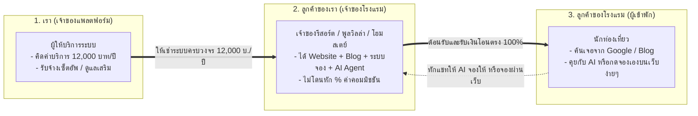

# 💼 01. การวิเคราะห์กลุ่มเป้าหมาย และแผนการสร้างรายได้แบบเข้าใจง่าย (Target Audience & Simple Monetization)

เอกสารฉบับนี้กำหนดทิศทางธุรกิจที่ชัดเจน ตรงไปตรงมา ไม่ซับซ้อน โดยยึดหลัก **"ขายง่าย เจ้าของโรงแรมตัดสินใจจ่ายได้ทันที คืนทุนไว และดูแลรักษาง่าย"**

---

## 👥 1. กลุ่มเป้าหมายหลัก (Target Audience)

ลูกค้าตัวจริงที่จ่ายเงินให้เรา คือ **"เจ้าของโรงแรม รีสอร์ต พูลวิลล่า และโฮมสเตย์ขนาดเล็ก–กลาง (3 – 40 ห้อง)"** ที่อยากยกระดับที่พักของตัวเองให้มีเว็บไซต์และระบบอัตโนมัติ โดยไม่ต้องจ้างโปรแกรมเมอร์หรือแอดมินราคาแพง

### เจาะลึกเจ้าของโรงแรม (ทำไมเขาถึงยอมจ่ายให้เรา?)

- **ลักษณะของเจ้าของโรงแรมกลุ่มนี้:**
  - เป็นเจ้าของรีสอร์ตต่างจังหวัด พูลวิลล่า แกลมปิ้ง หรือบูทีคโฮเทล (เช่น น่าน, เชียงใหม่, เขาใหญ่, ชลบุรี, กาญจนบุรี)
  - ปัจจุบันรับจองผ่าน **Facebook Page / LINE OA** (จดลงสมุดหรือ Google Sheet) หรือพึ่งพา **Agoda / Booking.com**
- **ปัญหาที่เขาปวดหัวทุกวัน (Pain Points):**
  1. **อยากมีเว็บไซต์สวยๆ ของตัวเอง แต่จ้างทำแพงมาก:** ไปถามเอเจนซี่โดนเรียก 50,000 – 150,000 บาท แถมไม่มีระบบจองจริง
  2. **เหนื่อยตอบแชทลูกค้าซ้ำๆ ดึกๆ ดื่นๆ:** ลูกค้าทักถามคำถามเดิมๆ ตอนห้าทุ่ม ("วันเสาร์นี้ว่างไหม", "หมาพักได้ไหม", "ราคาเท่าไหร่") ถ้าตอบช้าลูกค้าก็หนีไปจองที่อื่น จะจ้างแอดมินเฝ้ากะดึกก็เดือนละ 12,000 – 15,000 บาทแล้ว
  3. **โดน OTA (Agoda/Booking) หักค่าคอมฯ โหด 15% – 25%:** ขายห้องได้ 100,000 บาท โดนหักไปฟรีๆ 20,000 บาท
  4. **คนค้นหาใน Google ไม่เจอเว็บโรงแรม:** มีแต่เพจ Facebook ซึ่งค้นหาข้อมูลยาก และโดนปิดกั้นการมองเห็น ต้องจ่ายค่าแอดตลอดเวลา
- **สิ่งที่เขาอยากได้แบบ "ครบจบในที่เดียว":**
  - **Website สวยๆ** ที่ดูน่าเชื่อถือ มีแผนที่บ้านพักให้ลูกค้ากดเลือกดูได้
  - **Blog บทความ** เอาไว้ลงรีวิวที่เที่ยว คาเฟ่ใกล้เคียง เพื่อให้คนเสิร์ช Google แล้วเจอเว็บโรงแรมฟรีๆ
  - **ระบบจองและตรวจสลิป** ที่ลูกค้าโอนเงินเข้าบัญชีเจ้าของโรงแรมโดยตรง 100%
  - **AI Agent พนักงานต้อนรับอัจฉริยะ** ที่คอยตอบคำถาม เช็คห้องว่างจริง และ **กดจองห้องให้ลูกค้าได้เลยตลอด 24 ชม.**

---

## 💰 2. โมเดลการสร้างรายได้ (Simple & บ้านๆ Monetization)

เราตัดระบบแบ่งแพ็กเกจหลาย Tier ที่ชวนงง และตัดการหักเปอร์เซ็นต์ยิบย่อยทิ้งทั้งหมด เปลี่ยนเป็น **โมเดลเข้าใจง่าย คุย 1 นาทีเจ้าของโรงแรมเข้าใจทันที**

### 🌟 รายได้หลัก: แพ็กเกจ All-in-One รายปี `12,000 บาท / ปี`
*(เฉลี่ยเดือนละ 1,000 บาท หรือวันละ 33 บาท — แค่ขายห้องพักได้ 2–3 คืน ก็คืนทุนค่าเว็บทั้งปี!)*

**สิ่งที่เจ้าของโรงแรมได้รับในราคา 12,000 บาท/ปี:**
1. **🌐 Website โรงแรมระดับพรีเมียม:** หน้าเว็บดีไซน์สวยงาม รองรับมือถือ 100% พร้อมผังแผนที่เลือกบ้านพัก (Interactive Map)
2. **📝 ระบบ Blog & บทความ SEO:** เขียนบทความโปรโมตที่พักและสถานที่ท่องเที่ยวใกล้เคียงได้ไม่จำกัด (มี AI ช่วยร่างบทความให้)
3. **📅 ระบบจองห้องพัก + ปฏิทิน PMS + ตรวจสลิป:** ลูกค้าจองตรง โอนเงินผ่าน PromptPay เข้าบัญชีโรงแรมโดยตรง **ไม่หักค่าคอมมิชชัน (0% Commission)**
4. **🤖 ระบบ AI Agent รับจองแทน 24 ชม.:** AI เรียนรู้ข้อมูลของโรงแรม ตอบคำถามลูกค้า เช็คคิวว่างจากปฏิทินจริง และสร้างใบจองล็อคห้องให้ลูกค้าโอนเงินได้ทันที

---

### 🛠️ รายได้เสริมแบบ "Simple บ้านๆ" (ขายพ่วงง่าย กำไรดี ไม่ซับซ้อน)

เจ้าของโรงแรมส่วนใหญ่ **"มีเงินจ่าย แต่ไม่มีเวลามานั่งทำเอง"** จึงเป็นโอกาสทำเงินเสริมที่ตรงไปตรงมาที่สุด:

| ลำดับ | รูปแบบบริการเสริม (เข้าใจง่าย) | ราคาแนะนำ | รายละเอียดและเหตุผลที่ขายง่าย |
|---|---|---|---|
| **1** | **ค่าเซ็ตอัพเริ่มต้น "ทำเว็บให้พร้อมขาย" (Done-for-You Setup)** | **3,000 – 5,000 บาท** *(จ่ายครั้งเดียวตอนเริ่ม)* | เจ้าของแค่ส่งรูปห้องพักกับราคาให้เราใน LINE เราจัดการลงข้อมูลห้อง, ปักหมุดแผนที่, ตั้งค่า AI Agent และเขียน Blog เปิดหัวให้ 3 บทความ พร้อมใช้งานทันที |
| **2** | **รับวาดแผนที่รีสอร์ตสวยๆ (Custom Illustrated Map)** | **2,500 – 5,000 บาท** *(ต่อชิ้น)* | วาดภาพแผนที่มุมสูงของรีสอร์ตแบบน่ารักๆ หรือดูพรีเมียม เพื่อเอามาปักหมุดบ้านพักบนหน้าเว็บ (รีสอร์ตชอบมากเพราะเอาไปโพสต์ลงเพจเฟซบุ๊กต่อได้ด้วย) |
| **3** | **รับจ้างเขียนบทความ SEO ลง Blog / ดูแลเนื้อหา** | **เหมา 1,500 – 3,000 บาท** *(เช่น แพ็ก 5–10 บทความ)* | เขียนบทความดึงคนเข้าเว็บ เช่น *"รวม 7 จุดเช็คอินใกล้รีสอร์ต..."* เพื่อให้คนค้น Google เจอโรงแรมเยอะขึ้น |
| **4** | **ค่าจดและดูแลชื่อโดเมน .com ของโรงแรม** | **1,000 บาท / ปี** | จดชื่อเว็บเป็นชื่อโรงแรมโดยเฉพาะ (เช่น `www.sapanunseen.com`) ต้นทุนจริง ~350–400 บาท ที่เหลือเป็นค่าดูแลต่ออายุให้ลูกค้าไม่ต้องปวดหัวเรื่อง DNS |
| **5** | **เชื่อม AI Agent เข้า LINE OA / Facebook Page โรงแรม** | **3,000 – 5,000 บาท / ปี** *(หรือแพ็กเติมโควต้า AI)* | บนหน้าเว็บมี AI Agent ให้ฟรีในแพ็ก 12,000 อยู่แล้ว แต่ถ้าเจ้าของอยากให้ AI ตัวเดียวกันไปช่วยตอบและรับจองในแชท Facebook Page และ LINE OA ของโรงแรมด้วย ก็คิดค่าเชื่อมและดูแลรายปีเพิ่มแบบเหมาจ่ายง่ายๆ |
| **6** | **ระบบแจ้งเตือนสลิปและใบจองเข้ากลุ่ม LINE แอดมิน** | **รวมในแพ็กเกจ หรือเป็นจุดขายปิดการขาย** | เวลามีคนจองหรือ AI ปิดการขายได้ ระบบเด้งแจ้งเตือนเข้า LINE ของเจ้าของโรงแรมทันที |

---

## 📈 3. ทำไมโมเดล 12,000 บาท/ปี ถึงชนะคู่แข่งในตลาด?

| จุดเปรียบเทียบ | จ้างทำเว็บทั่วไป (WordPress) | ระบบ PMS ต่างประเทศ (Cloudbeds ฯลฯ) | **แพลตฟอร์มของเรา (12,000 บ./ปี)** |
|---|---|---|---|
| **ราคาและค่าใช้จ่าย** | จ่ายก้อนแรกแพง (30,000–100,000 บ.) ปีต่อไปมีค่าดูแลอีก | เดือนละ 3,000–8,000 บ. (ปีละ 36,000–100,000 บ.) | **เหมาจ่าย 12,000 บ./ปี (เดือนละพันเดียว)** |
| **ระบบจองห้องพัก** | มักเป็นแค่ฟอร์มส่งอีเมล ไม่ล็อคห้องจริง | มีระบบจองแต่หน้าเว็บไม่สวย ดูเป็นฟอร์มแข็งๆ | **เว็บสวยระดับรีสอร์ตหรู + ล็อคห้องตรวจสลิปจริง** |
| **AI ช่วยตอบและจองแทน** | ❌ ไม่มี | ❌ ไม่มี (หรือต้องซื้อแยกแพงมาก) | **✅ มี AI Agent รู้ข้อมูลโรงแรมและกดจองแทนได้** |
| **ระบบ Blog ดึงลูกค้า** | มีแต่เขียนยาก เจ้าของทำไม่เป็น | ❌ ไม่มีระบบ Blog/SEO | **✅ มีระบบ Blog ใช้งานง่าย พร้อม AI ช่วยเขียน** |
| **ความยากง่ายในการใช้งาน** | หลังบ้านซับซ้อน ปลั๊กอินพังบ่อย | เมนูภาษาอังกฤษ ศัพท์เทคนิคเยอะมาก | **✅ เมนูภาษาไทย เข้าใจง่าย เปิดผ่านมือถือได้สบาย** |

---

## 🎯 4. กลยุทธ์การทำให้ลูกค้าต่ออายุทุกปี (Retention Trick)

เพื่อให้เจ้าของโรงแรมจ่าย 12,000 บาทต่อเนื่องทุกปีแบบไม่ลังเล ในหน้าแดชบอร์ดหลังบ้านจะมี **"กล่องสรุปความคุ้มค่า"** แสดงให้เห็นชัดๆ ว่า:
- 💰 **ยอดจองผ่านเว็บและ AI ปีนี้:** เช่น `480,000 บาท`
- 🤖 **จำนวนการจองที่ AI Agent ช่วยปิดการขายให้ตอนดึก:** เช่น `35 รายการ (คิดเป็นเงิน 140,000 บาท)`
- 🎉 **ประหยัดค่าคอมฯ Agoda (20%) ไปได้แล้ว:** `96,000 บาท!` *(คุ้มค่าเช่าระบบ 12,000 บาทไปถึง 8 เท่า)*
