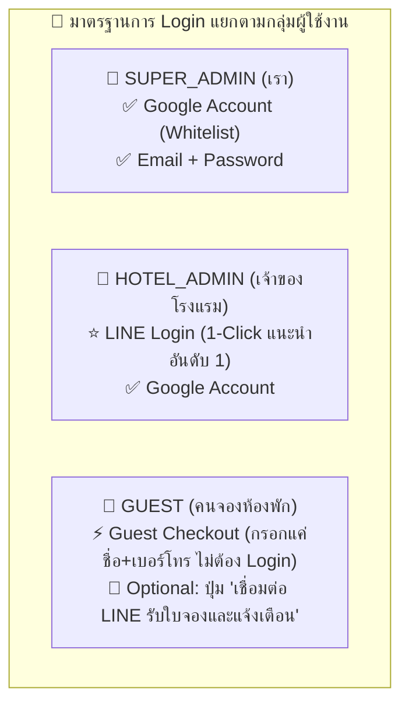
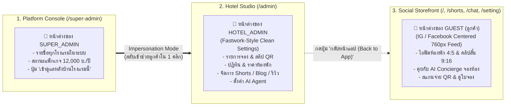

# 🛡️ 02. สถาปัตยกรรม Role, ระบบ Login และการแยก 3 หน้าต่างตามมาตรฐานสากล (Roles, Auth & 3-Portal Standard)

เอกสารฉบับนี้ออกแบบโครงสร้างผู้ใช้งาน **ระบบการเข้าสู่ระบบ (Authentication)** และ **การแยกหน้าต่างการทำงาน (3-Portal Architecture)** ให้สอดคล้องกับมาตรฐานเว็บแอปพลิเคชันระดับโลก (เช่น Shopify, Airbnb, Fastwork) โดยเน้นความง่ายสำหรับคนไทย

---

## 🗂️ 1. โครงสร้างบทบาทผู้ใช้งาน (3 บทบาทคนจริง + 1 AI Actor)

| บทบาท (Role) | รหัสในระบบ (`UserRole`) | คือใคร และทำหน้าที่อะไร? |
|---|---|---|
| **1. เจ้าของแพลตฟอร์ม (เรา)** | `SUPER_ADMIN` | ผู้ดูแลระบบกลาง สร้างเว็บให้โรงแรมใหม่, เช็ควันหมดอายุแพ็กเกจ 12,000 บ./ปี, และกดปุ่ม **"สวมรอยเข้าช่วยตั้งค่าเว็บให้โรงแรม (Impersonation)"** |
| **2. เจ้าของโรงแรม / แอดมินที่พัก** | `HOTEL_ADMIN` | ลูกค้าที่เช่าระบบ จัดการทุกอย่างของโรงแรมตัวเองผ่านหน้า `/admin`: ดูรายการจอง, ตั้งราคาห้อง, อัปโหลดคลิป `/shorts`, เขียนบทความ `/guide`, และตั้งค่าความรู้ให้ AI Agent |
| **3. ผู้ช่วย AI ประจำโรงแรม** | `AI_AGENT` *(System Actor)* | พนักงานต้อนรับอัจฉริยะในหน้า `/chat` และแชทมุมขวาล่าง ทำงาน 24 ชม. มีสิทธิ์ **อ่านตารางห้องว่างจริง, แนะนำห้อง/คูปอง, สร้างใบจอง (`HOLD_15_MIN`) และส่ง QR Code ให้ลูกค้าจ่ายเงินในแชทได้เลย** |
| **4. ลูกค้าผู้เข้าพัก (คนจอง)** | `GUEST` | นักท่องเที่ยวที่ไถดูฟีดห้องพัก `/`, ดูคลิปสั้น `/shorts`, อ่านรีวิว `/review`, อ่านคู่มือที่เที่ยว `/guide`, และกดจองห้องพักได้ทันทีโดยไม่บังคับสมัครสมาชิก |

---

## 🔐 2. ระบบ Login ที่เหมาะสมที่สุดสำหรับคนไทย (Authentication Strategy)

เราออกแบบวิธี Login แยกตามพฤติกรรมจริงของแต่ละบทบาท โดยเน้น **`LINE Login`** และ **`Google Account`** (ไม่ใช้ Facebook Login เพราะขั้นตอนตรวจเอกสารธุรกิจของ Meta ซับซ้อนและนโยบายเปลี่ยนบ่อย):

### ทำไม `HOTEL_ADMIN` ต้องเน้น `LINE Login` เป็นอันดับ 1?
1. **เข้าหลังบ้านผ่านมือถือใน 1 คลิก:** เจ้าของรีสอร์ตในไทยใช้สมาร์ทโฟนทำงานตลอดเวลา การกดปุ่ม *"เข้าสู่ระบบด้วย LINE"* ทำให้ไม่ต้องจำอีเมลหรือรหัสผ่านเลย
2. **ได้ `LINE User ID` มาส่งแจ้งเตือนฟรีอัตโนมัติ:** ทันทีที่เจ้าของโรงแรมล็อกอินด้วย LINE ระบบจะได้รหัส LINE ของเขามาผูกกับโรงแรมทันที เวลามีลูกค้าจองห้องหรือสแกน QR จ่ายเงินเสร็จ ระบบสามารถเด้งแจ้งเตือนเข้า LINE ของเจ้าของโรงแรมได้ทันทีโดยไม่ต้องตั้งค่า Token ให้ปวดหัว

### ทำไม `GUEST` ถึงใช้ระบบ `Guest Checkout + Optional LINE Login`?
1. **ตอนกดจองห้ามบังคับสร้างรหัสผ่าน:** เพื่อให้ลูกค้าจ่ายเงินจบไวที่สุดภายใน 3 คลิก (กรอกแค่ชื่อ + เบอร์โทร ก็รับ QR สแกนจ่ายได้เลย)
2. **มีปุ่มเสริม `[💚 ดึงข้อมูลจาก LINE & รับใบจองในแชท]`:** ถ้าลูกค้ากดปุ่มนี้ ระบบจะกรอกชื่อให้อัตโนมัติ และส่งลิงก์บัตรการจอง (Digital Voucher) เข้าแชท LINE ของลูกค้าทันที
3. **เช็คสถานะใบจองย้อนหลังง่ายๆ ที่หน้า `/setting`:** ลูกค้าสามารถค้นหาใบจองด้วย **รหัสการจอง หรือ เบอร์โทรศัพท์** ได้ทันที (ดังที่มีอยู่ใน `src/app/setting/page.tsx` ปัจจุบัน)

---

## 🖥️ 3. การแยก 3 หน้าต่างการทำงานตามมาตรฐานสากล (3-Portal Architecture)

ในระบบสากล หน้าต่างของ `SUPER_ADMIN`, `HOTEL_ADMIN`, และ `GUEST` **ต้องแยกออกจากกันอย่างชัดเจน 100%** ไม่ปะปนกัน:

### รายละเอียดความแตกต่างของแต่ละหน้าต่าง:

| มิติเปรียบเทียบ | 1. หน้าต่าง `SUPER_ADMIN` (`/super-admin`) | 2. หน้าต่าง `HOTEL_ADMIN` (`/admin`) | 3. หน้าต่าง `GUEST` (`/`, `/shorts`, `/chat`, `/setting`) |
|---|---|---|---|
| **ต้นแบบดีไซน์สากล** | **Shopify Partners / Vercel Dashboard** | **Fastwork.com Settings (`HotelOwnerStudioPanel.tsx`)** | **Instagram / Facebook Feed + Reels (`760px` Centered Feed)** |
| **จุดประสงค์หลัก** | บริหารจำนวนโรงแรมในระบบ เช็ควันต่ออายุรายปี 12,000 บาท และกดเข้าช่วยเซ็ตอัพเว็บให้ลูกค้า | จัดการโรงแรมของตัวเองแบบเรียบง่าย ไม่รกตา เปลี่ยนราคา เปิด/ปิดห้อง ลงคลิป/Blog และดูยอดจอง | ชมบรรยากาศที่พักผ่านคลิปสั้น รูปสวยๆ แชทถาม AI กดจองห้อง และสแกน QR จ่ายเงิน |
| **ฟีเจอร์พิเศษระดับสากล** | **Impersonation Bar:** เมื่อกดเข้าช่วยโรงแรมใด จะมีแถบสีด้านบนสุดบอกว่า *"กำลังดูในฐานะแอดมินของ: สะปัน อันซีน [กดเพื่อกลับ Super Admin]"* | **Clean Divided Rows (`.fw-setting-row`):** ทุกการตั้งค่าเป็นแถวสะอาดๆ กดแก้ไขในหน้าเดียว ไม่ต้องเปิดตารางซับซ้อน | **Social-First Experience:** กดหัวใจห้องพัก ดูคลิป 9:16 พร้อมการ์ดจองห้องฝังในคลิป และแชท AI สไตล์ Messenger |

---

## 📊 4. ตารางเปรียบเทียบสิทธิ์การเข้าถึง (Permission Matrix)

| หมวดหมู่ฟังก์ชัน | การกระทำ (Actions) | `SUPER_ADMIN` | `HOTEL_ADMIN` | `AI_AGENT` | `GUEST` |
|---|---|:---:|:---:|:---:|:---:|
| **ระดับแพลตฟอร์ม** | สร้างโรงแรมใหม่ / ต่ออายุแพ็กเกจ 12,000 บาท/ปี | ✅ | ❌ | ❌ | ❌ |
| | โหมดสวมรอยเข้าช่วยตั้งค่าให้โรงแรม (Impersonation) | ✅ | ❌ | ❌ | ❌ |
| **ข้อมูลแบรนด์ & รับเงิน** | แก้ไขชื่อโรงแรม, เลข PromptPay, เชื่อมต่อแจ้งเตือน LINE | ✅ | ✅ | อ่านข้อมูล | ดูหน้าเว็บ |
| **ห้องพัก & ราคา** | เพิ่ม/แก้ไขห้องพัก, รูป 4:5, ราคาวันธรรมดา/วันหยุด/เทศกาล | ✅ | ✅ | คำนวณราคา | ดูห้อง & เช็ควันว่าง |
| **Social & SEO Content** | จัดการคลิปสั้น (`/shorts`), บทความที่เที่ยว (`/guide`), รีวิว (`/review`) | ✅ | ✅ | ใช้แนะนำลูกค้า | ดูคลิป / อ่านบทความ |
| **ระบบ AI Concierge** | ตั้งค่าคำถามพบบ่อย (FAQ), กฎที่พัก, เปิด/ปิด AI รับจองอัตโนมัติ | ✅ | ✅ | ใช้เป็นสมองหลัก | แชทถามตอบกับ AI |
| **การจอง & ชำระเงิน QR** | สร้างใบจองล็อคห้อง 15 นาที + สร้าง Dynamic PromptPay QR | ✅ | ✅ | ✅ **(สร้างในแชทได้!)** | ✅ |
| | สแกนตรวจ QR สลิปอัตโนมัติ & เปลี่ยนสถานะเป็น `CONFIRMED` | ✅ | ✅ | ✅ *(ผ่านระบบ Auto-Slip)* | แนบสลิป / สแกนจ่าย |
