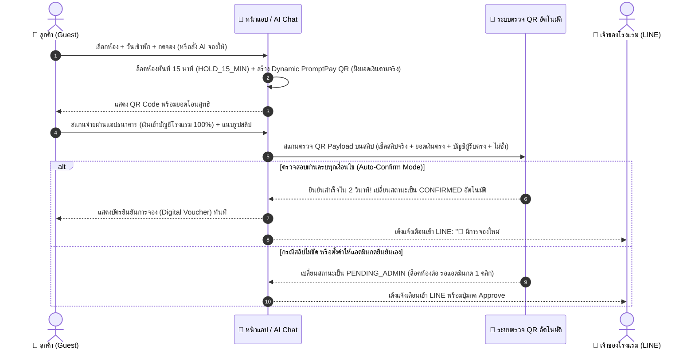
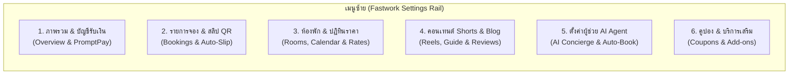

# 🖥️ 03. สถาปัตยกรรมระบบหลังบ้าน, ระบบสแกนจ่าย QR อัตโนมัติ และมาตรฐานการ Optimize (Admin, Auto-QR & Web Standards)

เอกสารฉบับนี้ออกแบบโดยอ้างอิงจาก **โครงสร้างโค้ดจริงของเว็บใหม่ (`src/`)** ซึ่งใช้ดีไซน์ **Social Media Application** สำหรับหน้าบ้าน และใช้ดีไซน์ **Fastwork-Style Minimalist Settings (`HotelOwnerStudioPanel.tsx`)** สำหรับหลังบ้าน พร้อมระบบจ่ายเงิน QR อัตโนมัติและการ Optimize ระดับโลก

---

## ⚡ 1. ระบบสร้าง QR Code และยืนยันการจองอัตโนมัติเมื่อสแกนจ่าย (Auto-QR Booking Engine)

เมื่อลูกค้ากดจองห้องพัก (ไม่ว่าจะกดจากหน้าฟีด `/`, กดจากในคลิป `/shorts`, หรือสั่งจองผ่านแชท `AI Agent`) ระบบรองรับการยืนยันการจองอัตโนมัติ **2 โหมดควบคู่กัน**:

### จุดเด่นของระบบ QR ในแพลตฟอร์มเรา:
1. **Dynamic PromptPay QR ฝังยอดเงิน:** ลูกค้าสแกนปุ๊บ ตัวเลขยอดเงินเด้งในแอปธนาคารทันที ไม่ต้องพิมพ์ตัวเลขเอง ป้องกันการโอนขาด/โอนเกิน และ **เงินโอนเข้าบัญชีธนาคารของเจ้าของโรงแรมโดยตรง 100% (ไม่หักค่าคอมฯ)**
2. **ตรวจสลิปยืนยันอัตโนมัติ (Auto-Slip Verification):** ถอดรหัส QR บนสลิปธนาคาร เช็คความถูกต้องของสลิป ยอดเงิน เลขบัญชี และป้องกันสลิปซ้ำ (`Duplicate Payload Guard`) เมื่อผ่านครบจะเปลี่ยนสถานะเป็น `CONFIRMED` ให้ทันทีโดยเจ้าของไม่ต้องเฝ้าจอ
3. **รองรับ Payment Gateway Webhook (สำหรับโรงแรมที่ต้องการแบบไม่ต้องแนบสลิป):** สามารถใส่ API Key ของ Stripe / Omise เพิ่มได้ หากต้องการให้สแกนจ่ายปุ๊บหน้าจอตัดจบอัตโนมัติโดยไม่ต้องอัปโหลดรูปสลิป

---

## 🧩 2. สถาปัตยกรรมหลังบ้าน `HOTEL_ADMIN` สไตล์ Fastwork Settings (`/admin`)

จากการตรวจสอบไฟล์ `src/components/HotelOwnerStudioPanel.tsx` ปัจจุบัน ระบบหลังบ้านถูกออกแบบในสไตล์ **Fastwork.com Settings** (การ์ดสีขาวขอบมน แบ่งซ้ายเป็นเมนูนำทาง ขวาเป็นแถวตั้งค่า `.fw-setting-row` ที่สะอาดตามาก)

เพื่อให้หลังบ้าน **เรียบง่าย (Simple) แต่จัดการเว็บสไตล์ Social Media ได้ครบ 100%** เราจึงจัดระเบียบเมนูด้านซ้ายของ `/admin` ออกเป็น **6 หมวดหลักที่เข้าใจง่ายที่สุด** (และตัดเมนู `Language` / `Privacy Policy` ที่ซ้ำซ้อนกับหน้า `/setting` ออก):

### รายละเอียดทั้ง 6 หมวดในหน้า `/admin`:

1. **`Overview & PromptPay` (ภาพรวมความคุ้มค่า & บัญชีรับเงิน):**
   - **การ์ดสรุปความคุ้มค่า (ROI Summary):** แสดงยอดจองรวมเดือนนี้/ปีนี้, ยอดขายที่ AI Agent ช่วยปิดการขายให้, และสถานะแพ็กเกจรายปี 12,000 บาท
   - **ข้อมูลแบรนด์ & บัญชีรับโอน:** แก้ไขชื่อโรงแรม, เบอร์โทร, LINE ID, และเลข **PromptPay ID + ชื่อบัญชี** สำหรับสร้าง QR รับเงิน
   - **การแจ้งเตือน LINE:** ปุ่มเชื่อมต่อ LINE ของเจ้าของโรงแรมเพื่อรับแจ้งเตือนใบจองใหม่ทันที
2. **`Bookings & Auto-Slip` (รายการจอง & ตรวจสลิป):**
   - แสดงรายการจองในรูปแบบแถว `.fw-setting-row` สะอาดตา พร้อมป้ายสถานะ (`ยืนยันแล้ว`, `รอตรวจสลิป`, `ล็อคห้อง 15 นาที`) และป้ายบอกที่มา (`🌐 หน้าเว็บ`, `🤖 AI จองให้`, `🎬 จากคลิป Shorts`)
   - ปุ่ม **`+ ลงคิวจองด่วน (Walk-in / LINE)`** สำหรับแอดมินกดล็อคห้องให้ลูกค้าที่โทรมาจองตรง
   - สวิตช์เปิด/ปิดโหมด **"อนุมัติใบจองอัตโนมัติเมื่อสแกน QR สลิปผ่าน"**
3. **`Rooms, Calendar & Rates` (จัดการห้องพัก, แผนที่ & ปฏิทินราคา):**
   - เพิ่ม/แก้ไขห้องพัก รูปภาพอัตราส่วน 4:5 (สำหรับโชว์เป็นการ์ดโพสต์บนหน้าฟีด `/`) และปักหมุดพิกัดบนแผนที่รีสอร์ต
   - ตั้งราคาแบบเข้าใจง่ายในแถวเดียว: **ราคาวันธรรมดา (อา.–พฤ.)**, **ราคาวันหยุด (ศ.–ส.)**, **ส่วนลด %**, และ **ปฏิทินจิ้มปิดห้อง/แก้ราคาวันเทศกาล**
4. **`Shorts, Guide & Reviews` (จัดการคอนเทนต์โซเชียล & บทความ SEO):** ⭐ *(เชื่อมกับหน้า `/shorts`, `/guide`, `/review`)*
   - **จัดการคลิปวิดีโอสั้น (`Shorts 9:16`):** อัปโหลดหรือใส่ลิงก์คลิปบรรยากาศที่พัก ผูกกับห้องพักและโค้ดคูปอง เพื่อให้ลูกค้าดูคลิปในหน้า `/shorts` แล้วกดจองห้องจากในคลิปได้เลย
   - **จัดการบทความท่องเที่ยว & คู่มือที่พัก (`SEO Blog & Guide`):** เขียนบทความรีวิวที่เที่ยว คาเฟ่ใกล้เคียง และคำถามพบบ่อย (มีปุ่ม **`✨ ให้ AI ช่วยร่างบทความ SEO`** ในคลิกเดียว) เพื่อดึงคนค้นหา Google เข้าเว็บ
   - **จัดการโพสต์รีวิวประทับใจ (`Social Reviews`):** เพิ่มรีวิวจากลูกค้าจริงเพื่อแสดงในหน้า `/review`
5. **`AI Concierge Setup` (ตั้งค่าผู้ช่วย AI ตอบแชทและรับจองแทน):** ⭐ *(เชื่อมกับหน้า `/chat` & Desktop Bubble)*
   - ตั้งชื่อ AI, ข้อความทักทายเริ่มต้น, และโทนการพูด
   - ช่องกรอก **ข้อมูลความรู้และกฎของที่พัก (Knowledge & Rules)** เป็นภาษามนุษย์ง่ายๆ (เช่น กฎสัตว์เลี้ยง, เวลารับประทานอาหารเช้า, เส้นทางรถยนต์)
   - สวิตช์เปิดโหมด **`AI Auto-Booking`:** อนุญาตให้ AI กดสร้างใบจองล็อคห้อง 15 นาทีและส่ง QR PromptPay ให้ลูกค้าสแกนจ่ายในหน้าแชทได้ทันที
6. **`Coupons & Add-ons` (คูปองส่วนลด & บริการเสริมหน้าห้อง):** *(เชื่อมกับหน้า `/deal`)*
   - สร้างโค้ดส่วนลด (เช่น `SAPAN10`, `DIRECT15`) และจัดการบริการเสริมขายพ่วง (เช่น ชุดหมูกระทะริมระเบียง, เซ็ตดริปกาแฟ, เตียงเสริม)

---

## 🌐 3. มาตรฐานการ Optimize ระดับโลก (World-Class Web & Social Optimization)

เพื่อให้เว็บไซต์ของทุกโรงแรมที่เช่าระบบ 12,000 บาท/ปี มีคุณภาพเทียบเท่าแพลตฟอร์มระดับโลก ทั้งในแง่ความเร็ว ภาพลักษณ์ และการติดอันดับ Google / AI Search เราจึงกำหนดมาตรฐานดังนี้:

| ด้านการ Optimize | มาตรฐานระดับโลกที่นำมาใช้ในระบบ | ประโยชน์ที่เจ้าของโรงแรมได้รับจริง |
|---|---|---|
| **1. Social-First UI & Typography (`standards.tsx` & `globals.css`)** | - บังคับใช้ **Centered Feed `760px`** เหมือนแอป IG/Facebook - บังคับใช้ **5-Tier Font Scale** (`24px / 18px / 16px / 14px / 12px`) ห้ามมีฟอนต์ขนาดมั่ว - รูปการ์ดห้องพักและรีวิวไร้ตัวหนังสือรกทับภาพ (Clean Media Standard) | หน้าเว็บดูแพง สะอาดตา ลูกค้าคุ้นเคยเหมือนกำลังเล่นแอปโซเชียลมีเดียบนมือถือ กดจองง่ายไม่สับสน |
| **2. SEO & AI Search Optimization (GEO)** | - สร้าง **JSON-LD Structured Data** อัตโนมัติทุกหน้า (`Hotel`, `HotelRoom`, `Offer`, `FAQPage`, `BlogPosting`, `VideoObject`) - สร้าง Sitemap.xml อัตโนมัติจากห้องพักและบทความในหน้า `/guide` | เวลาคนค้นหาใน Google หรือถาม ChatGPT / Gemini ว่า *"ที่พักสะปันวิวสวยมีหมูกระทะ"* ระบบค้นหาจะดึงข้อมูลเว็บโรงแรมและราคาห้องไปแนะนำทันที |
| **3. Social Sharing Cards (Dynamic OpenGraph)** | เมื่อลูกค้ากดปุ่ม `Share` การ์ดห้องพักหรือคลิป `/shorts` ไปยัง LINE หรือ Facebook จะขึ้นรูปปกห้องพัก ชื่อโรงแรม และราคาต่อคืนสวยงามอัตโนมัติ | ลูกค้าช่วยแชร์ห้องพักต่อให้เพื่อนในกลุ่ม LINE ได้น่าคลิกเหมือนแชร์โพสต์จากแอปดัง |
| **4. Performance & Core Web Vitals (60/120fps)** | - วิดีโอใน `/shorts` และหน้าแรกเล่นเฉพาะคลิปที่อยู่ในหน้าจอ (`IntersectionObserver` Auto-Play/Pause) - หน้าต่างจองห้องสไลด์ขึ้นด้วย GPU (`translate3d`) ไม่มีอาการกระตุกหรือหน้าจอกระโดด (`Scroll Lock`) | เปิดผ่านเน็ตมือถือบนดอยหรือต่างจังหวัดก็โหลดไว ลื่นไหลเหมือน Native App |

---

## 🌍 4. สถาปัตยกรรมระบบ Domain สำหรับ `HOTEL_ADMIN` (Hybrid Subdomain + Custom `.com` Domain)

เพื่อให้ตอบโจทย์เจ้าของโรงแรมที่ต้องการมีเว็บไซต์เป็นชื่อของตัวเอง พร้อมสร้างรายได้เสริมแบบบ้านๆ ให้แพลตฟอร์ม ระบบรองรับ **2 รูปแบบโดเมนควบคู่กัน (Hybrid Domain Architecture)** ตามมาตรฐาน SaaS ระดับโลก (Shopify / Wix / BentoWeb):

| รูปแบบโดเมน | ตัวอย่าง URL | เหมาะกับตอนไหน / ข้อดี |
| :--- | :--- | :--- |
| **1. Subdomain บนเว็บเรา (ได้ฟรีทันที)** | `sapanhaven.myhotel.app` | **ตอนเพิ่งสมัครวันแรก:** ลูกค้าสมัครปุ๊บ เว็บออนไลน์ทันทีใน 1 นาที เอาลิงก์ไปแปะหน้า Bio ของ IG / Facebook / LINE OA ได้เลยโดยไม่ต้องรอตั้งค่า DNS |
| **2. Custom Domain ชื่อลูกค้าเอง 100% (จุดขายหลัก)** | `www.sapanhaven.com` | **เมื่อใช้งานจริง:** เจ้าของโรงแรมที่จ่าย 12,000 บาท/ปี อยากได้ชื่อเว็บเป็นชื่อโรงแรมตัวเอง 100% ดูน่าเชื่อถือ ติดหน้าแรก Google (SEO) ในชื่อโรงแรมตัวเอง และทำให้ลูกค้า **ต่ออายุกับเราทุกปี** (เพราะถ้าเลิกใช้ เว็บ `.com` ของโรงแรมจะดับ) |

### 💡 โมเดลทำเงินและการทำงานทางเทคนิคของระบบ Domain:
1. **แพ็กเกจ 12,000 บาท/ปี:** แถมฟรี Subdomain (`ชื่อโรงแรม.myhotel.app`) + รองรับการนำโดเมน `.com` ที่มีอยู่แล้วมาผูกเองฟรีในหน้า `/admin`
2. **บริการเสริม "จดโดเมน `.com` พร้อมผูกให้เสร็จ" (+1,000 บาท/ปี):** ต้นทุนจดโดเมนจริงบน Cloudflare อยู่ที่ ~350 บาท/ปี แพลตฟอร์มได้กำไรส่วนต่าง ~650 บาท/ปี และเจ้าของโรงแรมไม่ต้องยุ่งเรื่องเทคนิคเลย
3. **การทำงานของโค้ด (Next.js Multi-Tenant Routing):** ใช้โค้ดและเซิร์ฟเวอร์ชุดเดียวทั้งหมด โดยใช้ `middleware.ts` อ่านค่า `Host` header ว่าลูกค้าเข้าผ่านโดเมนไหน แล้วดึงข้อมูลโรงแรมนั้น (`slug` หรือ `customDomain`) มาแสดงผลอัตโนมัติ
