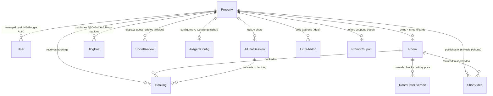

# 💾 04. การออกแบบ Database Schema และเทคโนโลยีระบบ (Database Schema & Tech Stack)

เอกสารฉบับนี้แสดงโครงสร้างฐานข้อมูล **Prisma ORM (PostgreSQL)** ที่เชื่อมโยงกับโครงสร้างโค้ดจริงของโปรเจกต์ (`src/data/rooms.ts`, `src/lib/store.ts`) และรองรับฟีเจอร์ครบทั้งหมด:
1. **3-Portal Role & LINE/Google Login** (`SUPER_ADMIN`, `HOTEL_ADMIN`, และ `GUEST`)
2. **Social-Commerce Content** (การ์ดห้องพัก 4:5, วิดีโอสั้น `/shorts`, โพสต์รีวิว `/review`, และบทความที่เที่ยว SEO `/guide`)
3. **Auto-QR Booking & Slip Verification** (สร้าง Dynamic PromptPay QR + ตรวจสลิปยืนยันการจองอัตโนมัติ)
4. **AI Concierge Auto-Booking** (ตั้งค่าความรู้ AI + บันทึกแชท + สร้างใบจองจากในแชท)

---

## 🛠️ 1. ชุดเทคโนโลยีและสถาปัตยกรรม (Technology Stack)

- **Frontend & Full-Stack Framework:** Next.js 15+ (App Router), React 19, TypeScript
- **UI & Design System:**
  - **Storefront (`/`, `/shorts`, `/chat`, `/deal`, `/review`, `/guide`, `/setting`):** Unified Social Feed Design System (`max-w-[760px]` Centered Feed, Strict 5-Tier Typography, Pure White Light Mode & Dark Mode)
  - **Hotel Admin (`/admin`):** Fastwork-Style 2-Column Minimalist Settings (`HotelOwnerStudioPanel.tsx` with `.fw-setting-row`)
  - **Super Admin (`/super-admin`):** Multi-Tenant SaaS Control Console + 1-Click Hotel Impersonation
- **Authentication:** NextAuth.js / Auth.js รองรับ **LINE Login** (พร้อมดึง `lineUserId` สำหรับส่งแจ้งเตือน), **Google OAuth**, และ Guest Checkout แบบไม่ต้องล็อกอิน
- **QR Payment & Auto-Slip Verification:**
  - EMVCo PromptPay Payload Generator (สร้าง QR Code ที่ฝังยอดเงินตามใบจองอัตโนมัติ)
  - Client & Server QR Scanner + Bank Slip Verification API (ตรวจสลิปจริง ยอดตรง บัญชีตรง และเปลี่ยนสถานะเป็น `CONFIRMED` อัตโนมัติ)
- **SEO & AI Discovery:** Next.js Metadata API + Dynamic OpenGraph Images + JSON-LD (`Hotel`, `HotelRoom`, `BlogPosting`, `VideoObject`, `FAQPage`)

---

## 🗄️ 2. แผนผังความสัมพันธ์ของข้อมูล (Entity-Relationship Diagram)



---

## 📐 3. โค้ดต้นแบบ Prisma Schema (รองรับ Social Feed + Auto-QR + AI Agent + LINE Login)

```prisma
datasource db {
  provider  = "postgresql"
  url       = env("DATABASE_URL")
  directUrl = env("DIRECT_URL")
}

generator client {
  provider = "prisma-client-js"
}

// -------------------------------------------------------------
// 1. ระบบผู้ใช้งาน & การเชื่อมต่อ LINE / Google (Auth & Roles)
// -------------------------------------------------------------
enum UserRole {
  SUPER_ADMIN   // เรา (เจ้าของแพลตฟอร์ม เข้าหน้า /super-admin)
  HOTEL_ADMIN   // เจ้าของโรงแรม / แอดมินหลัก (เข้าหน้า /admin)
  HOTEL_STAFF   // พนักงานช่วยดูคิว (เข้าหน้า /admin เฉพาะส่วนคิวจอง)
  GUEST         // ลูกค้าที่กดเชื่อม LINE Login เพื่อเก็บประวัติใบจอง (Optional)
}

model User {
  id            String    @id @default(cuid())
  email         String?   @unique
  phoneNumber   String?
  fullName      String
  avatarUrl     String?
  role          UserRole  @default(HOTEL_ADMIN)

  // OAuth Providers (เน้น LINE Login สำหรับคนไทย + Google Account)
  lineUserId    String?   @unique // ใช้ส่งแจ้งเตือนใบจอง/Voucher เข้าแชท LINE อัตโนมัติ!
  googleId      String?   @unique
  passwordHash  String?

  // ผูกกับโรงแรม (กรณีเป็น HOTEL_ADMIN / HOTEL_STAFF)
  propertyId    String?
  property      Property? @relation(fields: [propertyId], references: [id], onDelete: Cascade)

  createdAt     DateTime  @default(now())
  updatedAt     DateTime  @updatedAt

  @@index([propertyId, role])
}

// -------------------------------------------------------------
// 2. ข้อมูลโรงแรม, การตั้งค่า QR รับเงิน & แพ็กเกจ 12,000 บ./ปี
// -------------------------------------------------------------
enum SubscriptionStatus {
  TRIAL         // ทดลองใช้งาน
  ACTIVE        // ชำระรายปี 12,000 บาทแล้ว
  EXPIRED       // หมดอายุ รอต่อสัญญา
}

model Property {
  id                    String             @id @default(cuid())
  slug                  String             @unique // เช่น "sapan-unseen"
  customDomain          String?            @unique // เช่น "www.sapanunseen.com"
  brandCode             String             @default("SU")
  nameTh                String
  nameEn                String
  taglineTh             String?
  storyTh               String?
  heroImageUrl          String?
  resortMapImageUrl     String?

  // ข้อมูลติดต่อ & พิกัดแผนที่
  locationTh            String
  locationEn            String?
  latitude              Float              @default(19.1912)
  longitude             Float              @default(101.2005)
  contactPhones         String[]           @default([])
  lineId                String?
  email                 String?
  instagramUrl          String?
  facebookPageUrl       String?
  checkInTime           String             @default("14:00")
  checkOutTime          String             @default("11:00")

  // ระบบรับเงิน QR PromptPay & ยืนยันสลิปอัตโนมัติ
  promptPayId           String             // เบอร์โทร หรือ เลขนิติบุคคลสำหรับสร้าง Dynamic QR
  promptPayAccountName  String             // ชื่อบัญชีที่ใช้เช็คความตรงกันบนสลิป
  autoConfirmSlip       Boolean            @default(true) // true = สแกนสลิปตรงยอดแล้วเปลี่ยนเป็น CONFIRMED ทันที
  paymentGatewayKey     String?            // Optional: สำหรับโรงแรมที่ต้องการผูก Stripe/Omise Webhook

  // ข้อมูลแพ็กเกจรายปี (Simple 12,000 บาท/ปี)
  subscriptionStatus    SubscriptionStatus @default(ACTIVE)
  yearlyPriceThb        Int                @default(12000)
  subscriptionStartedAt DateTime           @default(now())
  subscriptionExpiresAt DateTime?

  // ความสัมพันธ์กับโมดูลต่างๆ
  users                 User[]
  rooms                 Room[]
  bookings              Booking[]
  shortVideos           ShortVideo[]
  blogPosts             BlogPost[]
  socialReviews         SocialReview[]
  addons                ExtraAddon[]
  promoCoupons          PromoCoupon[]
  aiConfig              AiAgentConfig?
  aiChatSessions        AiChatSession[]

  createdAt             DateTime           @default(now())
  updatedAt             DateTime           @updatedAt
}

// -------------------------------------------------------------
// 3. ห้องพัก (การ์ดโพสต์ 4:5 บนฟีด) & ปฏิทินคุมห้องรายวัน
// -------------------------------------------------------------
enum RoomInventoryMode {
  SINGLE_UNIT   // บ้านเดี่ยวเป็นหลัง (เช่น บ้าน A1, A2)
  ROOM_TYPE     // ประเภทห้องที่มีหลายยูนิต
}

model Room {
  id               String             @id @default(cuid())
  propertyId       String
  property         Property           @relation(fields: [propertyId], references: [id], onDelete: Cascade)

  code             String             // เช่น "A1", "A2"
  slug             String
  nameTh           String
  nameEn           String
  roomCategory     String             @default("VILLA") // "VILLA" | "SUITE" | "DELUXE"
  inventoryMode    RoomInventoryMode  @default(SINGLE_UNIT)
  totalUnits       Int                @default(1)

  shortDescTh      String
  basePriceThb     Int                // ราคาวันธรรมดา (อา.-พฤ.)
  weekendPriceThb  Int                // ราคาวันหยุด (ศ.-ส.)
  discountPercent  Int                @default(0)
  extraBedPriceThb Int                @default(850)
  sizeSqm          Int                @default(45)
  baseGuests       Int                @default(2)
  maxGuests        Int                @default(4)
  petsAllowed      Boolean            @default(false)
  statusMode       String             @default("ACTIVE") // "ACTIVE" | "MAINTENANCE"

  // พิกัดปักหมุดบนแผนที่รีสอร์ต
  mapX             Float              @default(50.0)
  mapY             Float              @default(50.0)

  imagesJson       String             // JSON Array รูปภาพอัตราส่วน 4:5 สำหรับฟีดโซเชียล
  amenitiesJson    String             // JSON Object สิ่งอำนวยความสะดวก

  bookings         Booking[]
  dateOverrides    RoomDateOverride[]
  shortVideos      ShortVideo[]

  createdAt        DateTime           @default(now())
  updatedAt        DateTime           @updatedAt

  @@unique([propertyId, code])
  @@unique([propertyId, slug])
}

model RoomDateOverride {
  id              String   @id @default(cuid())
  roomId          String
  room            Room     @relation(fields: [roomId], references: [id], onDelete: Cascade)
  dateStr         String   // "YYYY-MM-DD"
  isBlocked       Boolean  @default(false) // ปิดห้องรายวันบนปฏิทิน
  customPriceThb  Int?     // ราคาพิเศษเฉพาะวันหยุดยาว/เทศกาล
  titleTh         String?  // เช่น "วันหยุดปีใหม่"

  @@unique([roomId, dateStr])
}

// -------------------------------------------------------------
// 4. การจอง, Dynamic QR & การตรวจสลิปอัตโนมัติ (Bookings)
// -------------------------------------------------------------
enum BookingStatus {
  HOLD_15_MIN     // ล็อคห้องชั่วคราว 15 นาที พร้อมแสดง Dynamic QR
  PENDING_ADMIN   // แนบสลิปแล้ว รอแอดมินตรวจ (กรณีไม่ได้เปิด Auto-Confirm)
  CONFIRMED       // จ่ายเงินและตรวจสลิปผ่านแล้ว (ออกใบจองทันที)
  CANCELLED       // ยกเลิก หรือ หมดเวลา 15 นาที
}

enum BookingSource {
  WEBSITE         // กดจองจากหน้าฟีดหลัก (/)
  SHORTS_FEED     // กดจองจากคลิปวิดีโอสั้น (/shorts)
  AI_CHAT         // AI Concierge ช่วยปิดการขายและจองให้ (/chat)
  ADMIN_WALKIN    // แอดมินลงคิวเองในหน้า /admin
}

model Booking {
  id               String         @id @default(cuid())
  propertyId       String
  property         Property       @relation(fields: [propertyId], references: [id], onDelete: Cascade)
  roomId           String
  room             Room           @relation(fields: [roomId], references: [id], onDelete: Restrict)

  bookingCode      String         @unique // เช่น "SPN-8901"
  source           BookingSource  @default(WEBSITE)
  aiChatSessionId  String?
  aiChatSession    AiChatSession? @relation(fields: [aiChatSessionId], references: [id])

  unitsBooked      Int            @default(1)
  checkIn          String         // "YYYY-MM-DD"
  checkOut         String         // "YYYY-MM-DD"
  nights           Int
  guests           Int
  extraGuests      Int            @default(0)
  extraBedTotalThb Int            @default(0)

  // ข้อมูลผู้เข้าพัก (Guest Checkout ไม่บังคับสมัครสมาชิก)
  guestName        String
  guestPhone       String
  guestContact     String?        // LINE ID หรือ Email
  guestLineUserId  String?        // ถ้าลูกค้ากดปุ่มเชื่อม LINE ตอนจอง จะส่ง Voucher เข้าแชททันที
  guestNote        String?

  // บริการเสริมและคูปองส่วนลด
  addonsSelected   String?        // JSON Array ของ Add-ons และจำนวนที่เลือก
  addonsTotalThb   Int            @default(0)
  couponCode       String?
  couponDiscountThb Int           @default(0)
  roomSubtotalThb  Int
  totalPriceThb    Int            // ยอดสุทธิที่ใช้สร้าง Dynamic PromptPay QR

  // ข้อมูลการสแกนจ่าย QR และตรวจสลิปอัตโนมัติ
  slipDataUrl      String?
  slipQrVerified   Boolean        @default(false)
  slipQrPayload    String?        @unique // ป้องกันการใช้สลิปซ้ำ (Duplicate Slip Guard)
  holdExpiresAtIso DateTime

  status           BookingStatus  @default(HOLD_15_MIN)
  confirmedAt      DateTime?

  createdAt        DateTime       @default(now())
  updatedAt        DateTime       @updatedAt

  @@index([propertyId, status])
  @@index([propertyId, source])
  @@index([roomId, checkIn, checkOut])
}

// -------------------------------------------------------------
// 5. คอนเทนต์ Social Media & SEO (Shorts 9:16, Guide/Blog, Reviews)
// -------------------------------------------------------------

// คลิปวิดีโอสั้นแนวตั้ง 9:16 ในหน้า /shorts พร้อมปุ่มจองห้องและเก็บโค้ด
model ShortVideo {
  id          String   @id @default(cuid())
  propertyId  String
  property    Property @relation(fields: [propertyId], references: [id], onDelete: Cascade)

  titleTh     String
  titleEn     String?
  captionTh   String
  hashtags    String[] @default([])
  videoUrl    String
  posterUrl   String
  likesCount  Int      @default(1200)

  // ผูกกับห้องพักและคูปอง เพื่อให้คนดูคลิปแล้วกดจองห้องนี้ได้ทันที!
  linkedRoomId String?
  linkedRoom   Room?   @relation(fields: [linkedRoomId], references: [id], onDelete: SetNull)
  couponCode   String?

  isActive    Boolean  @default(true)
  sortOrder   Int      @default(0)
  createdAt   DateTime @default(now())
}

// บทความท่องเที่ยวและคู่มือที่พักในหน้า /guide (สำหรับทำ SEO ดึงคนจาก Google)
model BlogPost {
  id              String   @id @default(cuid())
  propertyId      String
  property        Property @relation(fields: [propertyId], references: [id], onDelete: Cascade)

  slug            String
  titleTh         String
  titleEn         String?
  excerptTh       String?  // ใช้ทำ Meta Description & JSON-LD SEO
  coverImageUrl   String
  contentMarkdown String
  category        String   @default("ATTRACTION") // "ATTRACTION" | "CAFE" | "TRAVEL_TIP" | "FAQ"
  distanceLabelTh String?  // เช่น "ห่างที่พัก 5 นาที"
  isPublished     Boolean  @default(true)

  createdAt       DateTime @default(now())
  updatedAt       DateTime @updatedAt

  @@unique([propertyId, slug])
}

// โพสต์รีวิวจากลูกค้าจริงในหน้า /review (สไตล์ Facebook Post Card)
model SocialReview {
  id           String   @id @default(cuid())
  propertyId   String
  property     Property @relation(fields: [propertyId], references: [id], onDelete: Cascade)

  authorName   String
  authorAvatar String?
  ratingScore  String   @default("10/10")
  roomCode     String?  // เช่น "A1"
  captionTh    String
  photosJson   String   // JSON Array รูปภาพรีวิว
  sourceUrl    String?  // ลิงก์โพสต์จริงบน Facebook / IG
  likesCount   Int      @default(500)
  isPublished  Boolean  @default(true)

  createdAt    DateTime @default(now())
}

// -------------------------------------------------------------
// 6. ระบบผู้ช่วย AI Concierge & Auto-Booking ในหน้า /chat
// -------------------------------------------------------------
model AiAgentConfig {
  id                 String   @id @default(cuid())
  propertyId         String   @unique
  property           Property @relation(fields: [propertyId], references: [id], onDelete: Cascade)

  agentName          String   @default("AI Concierge")
  greetingTh         String?
  faqAndRulesText    String?  // ข้อมูลคำถามพบบ่อยและกฎที่พักที่เจ้าของกรอกสอน AI
  autoBookingEnabled Boolean  @default(true) // อนุญาตให้ AI สร้างใบจองและส่ง QR ในแชท
  isActive           Boolean  @default(true)

  updatedAt          DateTime @updatedAt
}

model AiChatSession {
  id              String    @id @default(cuid())
  propertyId      String
  property        Property  @relation(fields: [propertyId], references: [id], onDelete: Cascade)

  channel         String    @default("WEB_CHAT") // "WEB_CHAT" | "LINE_OA"
  visitorName     String?
  visitorPhone    String?
  messagesJson    String    // ประวัติข้อความแชทและการ์ดห้องที่แนะนำ
  bookingsCreated Booking[]

  createdAt       DateTime  @default(now())
  updatedAt       DateTime  @updatedAt
}

// -------------------------------------------------------------
// 7. คูปองส่วนลด & บริการเสริมหน้าห้อง (/deal)
// -------------------------------------------------------------
model ExtraAddon {
  id         String   @id @default(cuid())
  propertyId String
  property   Property @relation(fields: [propertyId], references: [id], onDelete: Cascade)
  nameTh     String
  nameEn     String?
  descTh     String?
  priceThb   Int
  unitTh     String   @default("ต่อชุด")
  imageUrl   String?
  isActive   Boolean  @default(true)
}

model PromoCoupon {
  id            String   @id @default(cuid())
  propertyId    String
  property      Property @relation(fields: [propertyId], references: [id], onDelete: Cascade)
  code          String
  titleTh       String
  discountType  String   @default("PERCENT") // "PERCENT" | "FIXED"
  discountValue Int
  minSpendThb   Int      @default(0)
  imageUrl      String?
  isActive      Boolean  @default(true)

  @@unique([propertyId, code])
}
```
