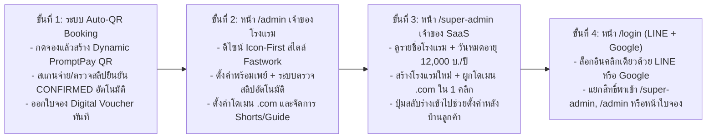

# 🗺️ Master Architecture & Project Plan — My Hotel Platform (Social-App & Simple SaaS Edition)

เอกสารชุดนี้เป็นพิมพ์เขียวแม่บท (Master Blueprint) ที่เชื่อมโยง **โมเดลธุรกิจ SaaS รายปี 12,000 บาท** เข้ากับ **สถาปัตยกรรมการออกแบบเว็บยุคใหม่สไตล์ Social Media Application** และ **ระบบหลังบ้านสไตล์ Minimalist Settings** ที่มีอยู่ในโค้ดปัจจุบัน (`src/`) อย่างสมบูรณ์

---

## 🎯 1. จุดยืนของแพลตฟอร์ม (Core Value Proposition)

> **"เปลี่ยนเว็บโรงแรมแบบเดิมที่ดูน่าเบื่อ ให้เป็นแอปจองที่พักสไตล์ Social Media (เหมือนไถ IG / TikTok / Messenger) พร้อมระบบ Blog SEO, ระบบสแกน QR จองอัตโนมัติ และ AI Agent ช่วยปิดการขาย 24 ชม. ในราคาเดียว 12,000 บาท/ปี"**

---

## 🎨 2. มาตรฐานการออกแบบของเว็บใหม่ (World-Class Design Standards จากโค้ดจริง)

> [!IMPORTANT]
> **กฎเหล็กสำหรับ AI Agent ก่อนการ Implement ทุกครั้ง:**
> ทุกครั้งที่มีการเขียนหรือแก้ไขโค้ด UI ในโปรเจกต์นี้ AI Agent **ต้องเข้าไปอ่านกติกาการออกแบบใน [`.agents/skills/my-hotel-design-system/SKILL.md`](../.agents/skills/my-hotel-design-system/SKILL.md) และ [`AGENTS.md`](../AGENTS.md) ก่อนเสมอ** โดยยึดหลัก **Icon-First (เน้นไอคอน ไม่เน้นตัวหนังสือเยอะ)** และ **Strict Monochrome Theme Tokens (`--color-accent`, `--color-on-accent`)** เท่านั้น

จากการตรวจสอบโครงสร้างโค้ดทั้งหมดในโปรเจกต์ ระบบถูกวางรากฐานด้วยมาตรฐานระดับโลก 4 แกนหลัก:

1. **หน้าบ้านสไตล์ Social Media Feed (`src/components/ui/standards.tsx` & `globals.css`):**
   - **Single Centered Feed (`max-w-[760px]`):** เลย์เอาต์ฟีดตรงกลางเหมือนไถ Facebook / Instagram เต็มจอไร้ขอบบนมือถือ และเป็นการ์ดขอบมน `rounded-[20px]` บนคอมพิวเตอร์
   - **Strict 5-Tier Typography Scale:** บังคับขนาดตัวอักษร 5 ระดับเท่านั้น (`ty-display` 24px, `ty-title` 18px, `ty-subtitle` 16px, `ty-body` 14px, `ty-caption` 12px) ทำให้หน้าเว็บดูสะอาดเป็นระเบียบทุกหน้าจอ
   - **Pure White Light Mode (`#ffffff`) & Sleek Dark Mode (`#1C1C1D`):** รองรับโหมดมืด/สว่างอัตโนมัติ พร้อมแถบเมนู **Desktop Left Rail (สไตล์ IG)** และ **Liquid Glass Bottom Nav** บนมือถือ
2. **ประสบการณ์การซื้อแบบ Social Commerce ครบวงจร:**
   - **Home Feed (`/`):** ช่องถาม AI ด้านบนสุด + แถบวิดีโอสั้น Reels + การ์ดห้องพักแนวตั้ง 4:5 (ปัดดูรูป กดหัวใจ แชร์ และกดจองได้ทันที)
   - **Short Video (`/shorts`):** ฟีดวิดีโอสั้นแนวตั้ง 9:16 เต็มจอ (สไตล์ TikTok / IG Reels) ที่มี **ปุ่มเก็บโค้ดส่วนลดและกดจองห้องพักที่อยู่ในคลิปได้ทันที**
   - **AI Concierge Chat (`/chat` & Desktop Bubble):** แชทสไตล์ IG DM / Messenger มีปุ่มส่งเสียง ส่งรูป กดหัวใจข้อความ และแสดงการ์ดห้องว่างพร้อมกดจองในแชท
   - **Verified Social Reviews (`/review`) & Travel Guide + Blog (`/guide`):** ฟีดรีวิวจากลูกค้าจริง และหน้าคู่มือท่องเที่ยว/บทความ SEO ดึงคนจาก Google
3. **ระบบหลังบ้านเรียบง่ายสไตล์ Fastwork Settings (`src/components/HotelOwnerStudioPanel.tsx`):**
   - ไม่ใช้ตาราง Dashboard รกๆ แบบระบบ ERP โบราณ แต่ใช้ **2-Column Split Settings Layout** (ซ้ายเป็นเมนูหลัก ขวาเป็นแถวตั้งค่า `.fw-setting-row` คั่นด้วยเส้นบางๆ) กดสลับหน้าด้วยแอนิเมชันลื่นไหล ใช้งานง่ายทั้งบนมือถือและคอมพิวเตอร์
4. **มาตรฐานการ Optimize ระดับโลก (SEO, GEO & Performance):**
   - **SEO & AI Search Ready:** โครงสร้าง HTML Semantic + JSON-LD (`Hotel`, `HotelRoom`, `Article`, `FAQPage`) + Dynamic OpenGraph (แชร์ลิงก์ห้องพักหรือบทความลง LINE/Facebook แล้วขึ้นรูปการ์ดสวยงาม)
   - **60/120fps App Feel:** GPU-accelerated Modal Slide-Up (`animate-slide-up-modal`), ซ่อน Scrollbar พื้นหลัง และล็อคห้องพร้อมตัดจบด้วย QR Code ทันที

---

## 📑 3. สารบัญเอกสารการวางแผน (Plan Directory Structure)

| เอกสาร | หัวข้อหลัก | รายละเอียดโดยสังเขป |
|---|---|---|
| [**01. วิเคราะห์กลุ่มเป้าหมาย & โมเดลรายได้**](./01-business-model-and-target-audience.md) | Target Audience & Simple Monetization | เจาะลึกกลุ่มเจ้าของโรงแรม โมเดลรายได้หลัก 12,000 บาท/ปี และช่องทางหารายได้เสริมแบบบ้านๆ เข้าใจง่าย |
| [**02. สถาปัตยกรรม Role, ระบบ Login & 3 หน้าต่างแยกกัน**](./02-roles-and-permissions-rbac.md) | Roles, LINE/Google Auth & 3 Portals | ระบบ Login ด้วย LINE/Google, การแยก 3 หน้าต่าง (`/super-admin`, `/admin`, Storefront) และโหมดสวมรอยช่วยเหลือลูกค้า (Impersonation) |
| [**03. สถาปัตยกรรมระบบหลังบ้าน & ระบบ QR อัตโนมัติ**](./03-admin-backoffice-architecture.md) | Fastwork-Style Admin, QR Auto-Verify & Optimization | โครงสร้างหลังบ้านสไตล์ `.fw-setting-row` ที่เรียบง่าย ระบบสแกนจ่าย QR ยืนยันการจองอัตโนมัติ การจัดการ Shorts/Blog และการตั้งค่า AI |
| [**04. การออกแบบ Database Schema & Tech Stack**](./04-database-schema-and-tech-stack.md) | Database Schema & Optimization Architecture | โครงสร้างฐานข้อมูล Prisma ที่รองรับ Multi-Property, LINE Auth, Shorts/Blog SEO, AI Chat Auto-Booking และ QR Slip Verification |

---

## 🚀 4. แผนการทำหน้าต่อไป (ลำดับการลงมือทำ 4 ขั้นตอน)

